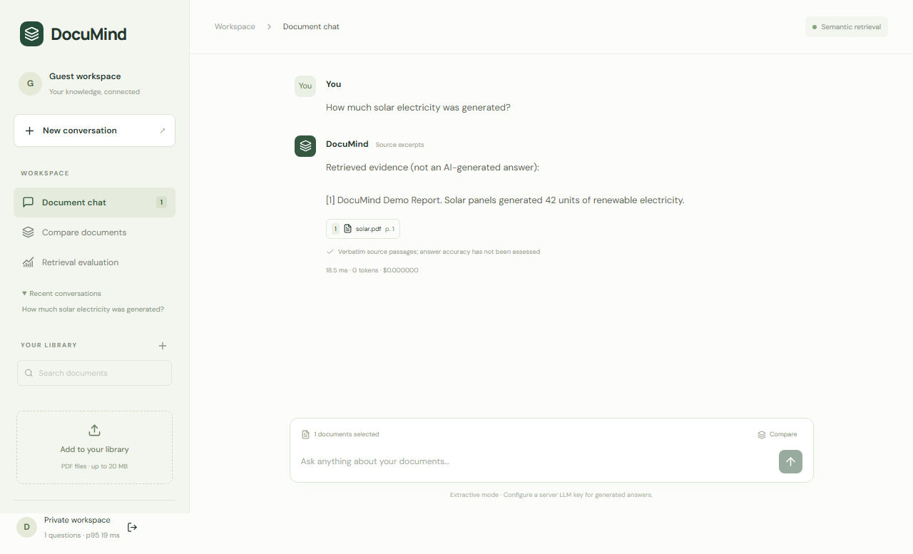
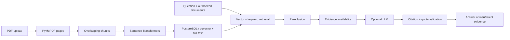

# DocuMind — Evaluated Retrieval-Augmented Document Intelligence

A document workspace for research papers, technical documentation, reports, and policies. Upload PDFs, ask questions, compare documents, and inspect page-specific citations. Evaluate retrieval instead of treating plausible answers as proof of correctness.



## What works

- React, TypeScript, Vite, and Tailwind interface with private workspaces and responsive layouts.
- FastAPI/Pydantic API, account registration/sign-in, opaque sessions, and owner-level access checks.
- PyMuPDF extraction with stable document/page/chunk IDs and configurable overlapping chunks.
- Sentence Transformers semantic embeddings, PostgreSQL/pgvector cosine search, full-text search, and reciprocal rank fusion.
- Stored PDF-page viewing and exact retrieved passages behind citations.
- Persistent conversations and multi-document questions/comparisons.
- Asynchronous processing status, failure states, owner-scoped duplicate detection, and indexed-chunk cleanup.
- Side-by-side vector/keyword/hybrid evaluation with Recall@5 and MRR@10.
- Latency, token counts, and configurable cost tracking.
- Configurable OpenAI-compatible generation with structured claims, exact supporting quotes, citation validation, and refusal.

Without an LLM key, DocuMind returns explicitly labeled source excerpts. This is useful for retrieval inspection; it does not pretend to generate an answer.

## Docker quickstart

```sh
cp .env.example .env
# Optionally configure OPENAI_API_KEY and your model/provider.
docker compose up --build
```

Open http://localhost:8080. Create an account or an isolated guest workspace. Upload a text-based PDF and wait until its status is Ready. The first semantic upload downloads the embedding model. PostgreSQL, PDFs, and model files persist in Docker volumes.

## Local development

From `backend`:

```sh
python -m venv .venv
# Activate the environment for your shell.
pip install -r requirements.txt
uvicorn app.main:app --reload --port 8000
```

From `frontend`, in another terminal:

```sh
npm ci
npm run dev
```

Use the URL printed by Vite. The frontend proxies `/api` to localhost:8000. Without DATABASE_URL, the backend uses a separate SQLite local profile. Semantic embeddings are the default. Set EMBEDDING_BACKEND=lexical explicitly for lightweight development/tests. Never present that profile as semantic AI.

Environment variables are read from the process; Docker Compose loads `.env`. For direct development, export variables in your shell. Configurable settings include provider base URL/model/key, database URL, embedding model (384 dimensions), chunk size/overlap, similarity threshold, fusion constant, secure cookies, guest access, and per-million token rates.

## Architecture



See [architecture](docs/architecture.md) for ownership, storage, request lifecycle, and generation boundaries.

## Measured evaluation

The reproducible corpus contains **74 self-authored synthetic questions**. On the local semantic/SQLite run, hybrid Recall@5 and MRR@10 were 1.0, and retrieval abstention recall was 0.889. This simple smoke benchmark does **not** establish real-paper answer accuracy. The error analysis retains the original poor keyword abstention result and explains the fix. No generated-answer accuracy or hallucination-detection rate is claimed.

See [evaluation methodology and limitations](docs/evaluation.md), [labeled corpus](evaluations/datasets/synthetic.json), and [raw measured results](evaluations/results-semantic.json).

```sh
# From backend:
python -m pytest -q
python ../evaluations/create_dataset.py
python ../evaluations/evaluate_retrieval.py --semantic

# From frontend, while both development servers are running:
npx playwright install chromium
PREVIEW_URL=http://127.0.0.1:5173 npm run test:e2e
```

On PowerShell, set `$env:PREVIEW_URL='http://127.0.0.1:5173'` before the Playwright command. Tests cover upload validation, duplicate files, scanned PDFs, chunk overlap, fusion, unauthorized access, persisted history, unsupported questions, quote validation, malicious instructions, and the browser workflow. CI runs SQLite and PostgreSQL suites, frontend builds, and Playwright.

## API examples

Interactive API documentation is available at http://localhost:8000/docs in local development. Authenticate through `/api/auth/register`, `/api/auth/login`, or `/api/auth/guest`, retaining the returned session cookie.

```json
POST /api/ask
{
  "question": "Compare the training costs. What does each report establish?",
  "document_ids": ["DOCUMENT_A", "DOCUMENT_B"],
  "compare": true,
  "retrieval_mode": "hybrid"
}
```

```json
POST /api/evaluate
[
  {
    "question": "What training cost was reported?",
    "document_ids": ["DOCUMENT_A"],
    "expected": [{"document_id": "DOCUMENT_A", "page": 4}]
  }
]
```

An empty expected array labels an intentionally unanswerable case. Evaluation results include each baseline's sources for error analysis. Add a conversation_id to `/api/ask` to continue a saved conversation.

## Honest limitations

Exact-quote and citation validation is a useful failure check, **not proof that a generated claim follows from evidence**. Real-provider answers and prompt-injection resistance require further labeled evaluation. The included injection test checks prompt separation and validation using a mocked provider.

OCR, optional reranking, S3, streamed answers, durable ingestion queues, and account recovery are future work. The initial migration creates tables/indexes idempotently; it is not a full versioned upgrade framework. Chat citations can outlive deleted PDFs. Larger libraries need retrieval/load benchmarks and background ingestion isolation.

Keep this version bound to localhost. Before public deployment, add rate limits and storage quotas, use HTTPS and Secure cookies, disable guest registration, and configure backups. Upload text is sent to the generation provider only when a provider key is configured. Never commit keys, sessions, uploads, or model caches.

[Deployment guide](docs/deployment.md). A live public URL and narrated demonstration video are not yet available; the repository includes a real browser screenshot and reproducible local demonstration.
