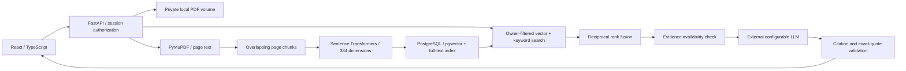

# DocuMind architecture

PDFs remain server-side. Uploads are stored under random identifiers, with their original filenames retained only as metadata. Document hashes identify duplicates within each owner, avoiding cross-user information leakage. Background ingestion marks documents as parsing, embedding, ready, or failed. Restarted incomplete jobs become failed and can be re-uploaded. The current FastAPI background task runs in-process; a durable queue is a future improvement.

Every document, PDF, chunk, conversation, and evaluation request checks an opaque session against an owner. Cookies are HTTP-only with SameSite strict and optional Secure. Passwords use salted PBKDF2. The development proxy and nginx preserve the original Host for cross-origin write checks.

PostgreSQL uses cosine distance with an HNSW index and English full-text search with GIN. Candidate lists are owner/document/model filtered before fusion. SQLite is an explicit local profile, using stored vectors and BM25 in Python. It is not the PostgreSQL performance baseline. Every stored embedding has a model identifier; changing models requires reingestion.

The LLM receives retrieved evidence as untrusted user-message JSON, separate from system instructions. It emits claims with citation numbers and exact supporting quotes. Missing evidence, provider refusal, invalid references, and fabricated quotes trigger refusal. Quote presence does not prove that a claim follows from the quote; human-labeled claim support remains necessary.

Usage records contain latency, provider token counts, and optional cost computed from configured rates. Missing rates yield unknown cost, rather than an invented estimate. Conversations persist in the database and can be reopened.
